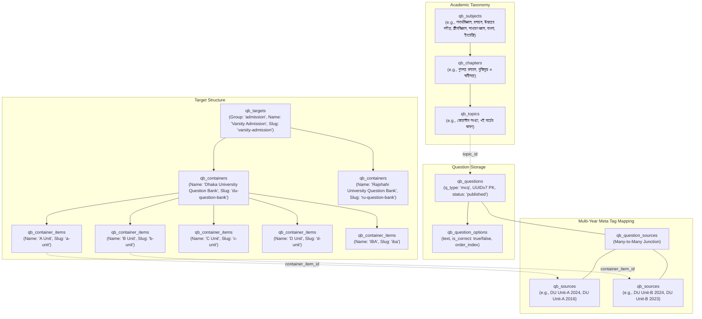

# 📖 Complete Question Bank Archive Import Documentation

This document provides complete end-to-end technical documentation of how past admission test archives from StudyClubBD are scraped, structured, and imported into the PostgreSQL 3NF database.

---

## 1. Architectural Mapping & Hierarchy Resolution

The platform’s data is structured to map into our 3NF database schema:



---

## 2. Reverse-Engineered Internal API Endpoints

### 2.1 Hierarchy Tree Discovery Endpoint
- **Endpoint:** `GET https://studyclubd.com/qb-archive/includes/ajax.php`
- **Query Parameters Used:**
  - `step=year&family=University&university=UNI_J32I8G&unit={UNIT_CODE}`:
    - DU A Unit: `unit=UNI_6321c505`
    - DU B Unit: `unit=UNI_f20da169`
  - `step=chapters&university=UNI_J32I8G&unit={UNIT_CODE}&subject={SUB_CODE}`:
    - Discovers all chapters for each subject.
  - `step=topics&university=UNI_J32I8G&unit={UNIT_CODE}&subject={SUB_CODE}&chapter={CHAP_CODE}`:
    - DU A Unit: 703 topic queues.
    - DU B Unit: 773 topic queues.

### 2.2 Question Fetching API
- **Endpoint:** `GET https://studyclubd.com/view-question1/`
- **Query Parameters Used:**
  `?university=UNI_J32I8G&unit={UNIT_CODE}&subject=SUB_...&chapter=CHA_...&topic=TOP_...&spa_ajax=1&page={PAGE}`
- **Payload Format:**
  ```json
  {
    "html": "<div class='mcq-item' data-db-id='23773'>...</div>",
    "has_more": true,
    "current_page": 1,
    "total_pages": 3
  }
  ```

---

## 3. Step-by-Step Data Pipeline

### Step 1: Target, Container, and Container Item Initialization
- `qb_targets`: Varsity Admission (`slug: 'varsity-admission'`, `group: 'admission'`)
- `qb_containers`: 
  - Dhaka University Question Bank (`slug: 'du-question-bank'`)
  - Rajshahi University Question Bank (`slug: 'ru-question-bank'`)
- `qb_container_items`:
  - DU A Unit: `A Unit (বিজ্ঞান অনুষদ)` (`slug: 'a-unit'`, `order_index: 1`)
  - DU B Unit: `B Unit (কলা, আইন ও সামাজিক বিজ্ঞান অনুষদ)` (`slug: 'b-unit'`, `order_index: 2`)
  - DU C Unit: `C Unit (ব্যবসায় শিক্ষা অনুষদ)` (`slug: 'c-unit'`, `order_index: 3`)
  - DU D Unit: `D Unit (বিভাগ পরিবর্তন অনুষদ)` (`slug: 'd-unit'`, `order_index: 4`)
  - DU IBA: `IBA (ব্যবসায় প্রশাসন ইনস্টিটিউট)` (`slug: 'iba'`, `order_index: 5`)
  - RU A Unit: `A Unit (কলা, আইন ও সামাজিক বিজ্ঞান অনুষদ)` (`slug: 'a-unit'`, `order_index: 1`)

### Step 2: Extraction, Cleansing & Strict Subject Scoping
- Scrapes question HTML via Cheerio:
  - Cleaned LaTeX/Bangla text.
  - MCQ options (4 options per question with `is_correct` boolean).
  - Multi-year meta tags (e.g. `[DU : Unit-A : 2024]`, `[DU : Unit-B : 2023]`).
- **Subject Scoping:**
  - **DU A Unit (`a-unit`):** Retains strictly the 11 official subjects: Physics (1st & 2nd), Chemistry (1st & 2nd), Higher Math (1st & 2nd), Biology (1st & 2nd), English, and Bangla (1st & 2nd).
  - **DU B Unit (`b-unit`):** Retains strictly the 5 Core B Unit subjects: General Knowledge Bangladesh, General Knowledge International, English, Bangla Literature, and Bangla Grammar.
  - **DU C Unit (`c-unit`):** Retains strictly the 6 Core Business disciplines: Accounting, Business Org, Finance, Marketing, Bangla, English.
  - **DU IBA (`iba`):** Retains strictly Analytical IQ, English Verbal, and Basic Quantitative Math.
  - **RU A Unit (`a-unit`):** Retains strictly the 5 official core subjects (Bangla Literature, Bangla Grammar, English, GK Bangladesh, GK International) — removing stray physics/biology/civics artifacts.
  - **RU B Unit (`b-unit`):** Retains strictly Commerce & Non-Commerce core subjects (Accounting 1 & 2, Business Org 1 & 2, Finance 1 & 2, Marketing 1 & 2, English, Bangla, GK) — removing stray physics/chemistry/civics artifacts.
  - **RU C Unit (`c-unit`):** Retains strictly the 9 Science & ICT core subjects (Higher Math 1 & 2, Physics 1 & 2, Chemistry 1 & 2, Biology 1 & 2, ICT) — removing stray GK/Bangla/English artifacts.

### Step 3: Meta Tag Normalization & Multi-Source Linking
- Deduplicates and normalizes tags into structured year and institution sources.
- Inserts/retrieves cached `qb_sources` linked to the specific `container_item_id`.
- Connects `qb_questions` to `qb_sources` via `qb_question_sources` junction.

### Step 4: Count Recalculation
Runs `recalculateAllCounts()` to synchronize:
- Topics (`qb_topics.question_count`)
- Chapters (`qb_chapters.question_count`)
- Subjects (`qb_subjects.question_count`, `chapter_count`)
- Sources (`qb_sources.question_count`)
- Container Items (`qb_container_items.question_count`)
- Containers (`qb_containers.question_count`, `item_count`)
- Targets (`qb_targets.question_count`)

---

## 4. Current Cleaned Import Statistics (Two-Pass Hybrid Import)

### 4.1 Dhaka University Question Bank (`du-question-bank`)
| Entity / Metric | DU A Unit (`a-unit`) | DU B Unit (`b-unit`) | DU C Unit (`c-unit`) | DU IBA (`iba`) | Total (DU Question Bank) |
|---|---|---|---|---|---|
| **Source URL** | `unit=UNI_6321c505` | `unit=UNI_f20da169` | `unit=UNI_d8e1d188` | `unit=UNI_09df8d45` | `university=UNI_J32I8G` |
| **Questions Active** | **4,728** | **2,606** | **3,235** | **930** | **11,499** |
| **Subjects** | **11** (Science + Lang) | **5** (Core GK, Eng, Ban) | **12** (Commerce & Lang) | **3** (English, Math, IQ) | **19** unique subjects |
| **Exam Sources / Batches** | 32 (1995–2025) | 30 (1996–2025) | 32 (1991–2025) | 26 (1998–2024) | **120** source links |
| **Import Script** | `apps/server/scripts/import-du-a-unit.ts` | `apps/server/scripts/import-du-b-unit.ts` | `apps/server/scripts/import-du-c-unit.ts` | `apps/server/scripts/import-du-iba.ts` | — |

### 4.2 Rajshahi University Question Bank (`ru-question-bank`)
| Entity / Metric | RU A Unit (`a-unit`) | RU B Unit (`b-unit`) | RU C Unit (`c-unit`) | Total (RU Question Bank) |
|---|---|---|---|---|
| **Source URL** | `step=year&university=UNI_HSQQTE&unit=UNI_6321c505` | `step=year&university=UNI_HSQQTE&unit=UNI_f20da169` | `step=year&university=UNI_HSQQTE&unit=UNI_d8e1d188` | `university=UNI_HSQQTE` |
| **Questions Active** | **3,026** | **1,814** | **3,911** | **8,751** |
| **Subjects** | **5** (Core GK, Eng, Ban) | **13** (Commerce & Non-Commerce) | **9** (Science & ICT) | **22** unique core subjects |
| **Exam Sources / Batches** | 37 (2010–2024 sets) | 17 (2010–2024 sets) | 34 (2010–2024 sets) | **88** source batches |
| **Import Script** | `apps/server/scripts/import-ru-a-unit.ts` | `apps/server/scripts/import-ru-b-unit.ts` | `apps/server/scripts/import-ru-c-unit.ts` | — |

### 4.3 Chittagong University Question Bank (`cu-question-bank`)
| Entity / Metric | CU A Unit (`a-unit`) | CU B Unit (`b-unit`) | CU C Unit (`c-unit`) | CU D Unit (`d-unit`) | Total (CU Question Bank) |
|---|---|---|---|---|---|
| **Source URL** | `step=year&university=UNI_5WRL0D&unit=UNI_6321c505` | `step=year&university=UNI_5WRL0D&unit=UNI_f20da169` | `step=year&university=UNI_5WRL0D&unit=UNI_d8e1d188` | `step=year&university=UNI_5WRL0D&unit=UNI_79515993` | `university=UNI_5WRL0D` |
| **Questions Active** | **3,282** | **2,342** | **1,689** | **3,212** | **10,525** |
| **Subjects** | **12** (Science, Language & ICT) | **5** (Core GK, Eng, Ban) | **11** (Commerce & Language) | **10** (Faculty Change Core) | **21** unique core subjects |
| **Exam Sources / Batches** | 29 (2006–2025 sets) | 22 (2003–2024 sets) | 20 (2001–2024 sets) | 20 (2005–2025 sets) | **91** source batches |
| **Import Script** | `apps/server/scripts/import-cu-a-unit.ts` | `apps/server/scripts/import-cu-b-unit.ts` | `apps/server/scripts/import-cu-c-unit.ts` | `apps/server/scripts/import-cu-d-unit.ts` | — |

### 4.4 Jagannath University Question Bank (`jnu-question-bank`)
| Entity / Metric | JnU A Unit (`a-unit`) | JnU B Unit (`b-unit`) | JnU C Unit (`c-unit`) | JnU D Unit (`d-unit`) | JnU E Unit (`e-unit`) | Total (JnU Question Bank) |
|---|---|---|---|---|---|---|
| **Source URL** | `step=year&university=UNI_9OJVFD&unit=UNI_6321c505` | `step=year&university=UNI_9OJVFD&unit=UNI_f20da169` | `step=year&university=UNI_9OJVFD&unit=UNI_d8e1d188` | `step=year&university=UNI_9OJVFD&unit=UNI_79515993` | `step=year&university=UNI_9OJVFD&unit=UNI_7a52cb22` | `university=UNI_9OJVFD` |
| **Questions Active** | **1,559** | **1,164** | **1,388** | **1,051** | **60** | **5,222** |
| **Subjects** | **11** (Higher Math 1 & 2, Physics 1 & 2, Chemistry 1 & 2, Biology 1 & 2, English, Bangla) | **5** (English, Bangla Grammar, GK BD, GK Int, Bangla Literature) | **17** (English, Accounting 1 & 2, General Math, Business Org 1 & 2, Finance 1 & 2, GK, Bangla, Economics 1 & 2, Marketing 1 & 2, IQ) | **5** (English, Bangla Grammar, GK Int, GK BD, Bangla Literature) | **5** (English, GK BD, Bangla Literature, Bangla Grammar, GK Int) | **21** unique core subjects |
| **Exam Sources / Batches** | 15 (2006–2025 sets) | 16 (2005–2024 sets) | 17 (2004–2025 sets) | 14 (2005–2024 sets) | 5 (2018–2024 sets) | **67** source batches |
| **Import Script** | `apps/server/scripts/import-jnu-a-unit.ts` | `apps/server/scripts/import-jnu-b-unit.ts` | `apps/server/scripts/import-jnu-c-unit.ts` | `apps/server/scripts/import-jnu-d-unit.ts` | `apps/server/scripts/import-jnu-e-unit.ts` | — |

### 4.5 Khulna University Question Bank (`ku-question-bank`)
| Entity / Metric | KU A Unit (`a-unit`) | KU B Unit (`b-unit`) | KU C Unit (`c-unit`) | KU D Unit (`d-unit`) | Total (KU Question Bank) |
|---|---|---|---|---|---|
| **Source URL** | `step=year&university=UNI_C9CQ1X&unit=UNI_6321c505` | `step=year&university=UNI_C9CQ1X&unit=UNI_f20da169` | `step=year&university=UNI_C9CQ1X&unit=UNI_d8e1d188` | `step=year&university=UNI_C9CQ1X&unit=UNI_79515993` | `university=UNI_C9CQ1X` |
| **Questions Active** | **1,590** | **1,771** | **254** | **118** | **3,733** |
| **Subjects** | **13** (Higher Math 1 & 2, Physics 1 & 2, Chemistry 1 & 2, Biology 1 & 2, English, IQ, GK BD, GK Int, ICT) | **26** (English, GK BD, GK Int, Bangla Grammar, IQ, Bangla Literature, Physics 1 & 2, Chemistry 1 & 2, Economics 1 & 2, Higher Math 1 & 2, Biology 1 & 2, Civics 1 & 2, Accounting 1 & 2, Finance 1 & 2, Management 1 & 2, General Science, General Math) | **6** (English, IQ, GK Int, GK BD, Bangla Grammar, Bangla Literature) | **5** (English, IQ, GK BD, GK Int, General Math) | **27** unique core subjects |
| **Exam Sources / Batches** | 16 (2009–2024 sets) | 16 (2009–2024 sets) | 16 (2009–2024 sets) | 15 (2009–2024 sets) | **63** source batches |
| **Import Script** | `apps/server/scripts/import-ku-units.ts` | `apps/server/scripts/import-ku-units.ts` | `apps/server/scripts/import-ku-units.ts` | `apps/server/scripts/import-ku-units.ts` | — |

### 4.6 BUP Question Bank (`bup-question-bank`)
| Entity / Metric | BUP FASS (`fass`) | BUP FBS (`fbs`) | BUP FSSS (`fsss`) | BUP FST (`fst`) | Total (BUP Question Bank) |
|---|---|---|---|---|---|
| **Source URL** | `step=year&university=UNI_W9MU53&unit=UNI_ebd5fd78` | `step=year&university=UNI_W9MU53&unit=UNI_a1249f92` | `step=year&university=UNI_W9MU53&unit=UNI_b7baf9bd` | `step=year&university=UNI_W9MU53&unit=UNI_1db6915c` | `university=UNI_W9MU53` |
| **Questions Active** | **951** | **876** | **940** | **919** | **3,686** |
| **Subjects** | **7** (English, GK BD, GK Int, Bangla Grammar, Bangla Literature, IQ, ICT) | **7** (English, General Math, GK BD, GK Int, IQ, Higher Math 1 & 2) | **6** (English, GK Int, GK BD, Bangla Grammar, Bangla Literature, IQ) | **9** (Higher Math 1 & 2, English, Chemistry 1 & 2, Physics 1 & 2, Biology 1 & 2) | **14** unique core subjects |
| **Exam Sources / Batches** | 14 (2011–2024 sets) | 14 (2011–2024 sets) | 14 (2011–2024 sets) | 14 (2011–2024 sets) | **56** source batches |
| **Import Script** | `apps/server/scripts/import-bup-units.ts` | `apps/server/scripts/import-bup-units.ts` | `apps/server/scripts/import-bup-units.ts` | `apps/server/scripts/import-bup-units.ts` | — |

### 4.7 Shahjalal University Question Bank (`sust-question-bank`)
| Entity / Metric | SUST A Unit (`a-unit`) | SUST B Unit (`b-unit`) | Total (SUST Question Bank) |
|---|---|---|---|
| **Source URL** | `step=year&university=UNI_UUSNVJ&unit=UNI_6321c505` | `step=year&university=UNI_UUSNVJ&unit=UNI_f20da169` | `university=UNI_UUSNVJ` |
| **Questions Active** | **674** | **2,729** | **3,403** |
| **Subjects** | **14** (English, Bangla Grammar, Bangla Literature, Higher Math 1 & 2, Biology 1 & 2, GK BD, GK Int, Chemistry 1 & 2, Physics 1 & 2, Economics) | **17** (English, Higher Math 1 & 2, Physics 1 & 2, Chemistry 1 & 2, Bangla Grammar, Bangla Literature, GK BD, GK Int, Economics, General Math, IQ, Biology 1 & 2, Civics) | **17** unique core subjects |
| **Exam Sources / Batches** | 16 (2007–2024 sets) | 16 (2007–2024 sets) | **32** source batches |
| **Import Script** | `apps/server/scripts/import-sust-units.ts` | `apps/server/scripts/import-sust-units.ts` | — |

### 4.9 Jahangirnagar University Question Bank (`ju-question-bank`)
| Entity / Metric | Unit A (`a-unit`) | Unit B (`b-unit`) | Unit C (`c-unit`) | Unit D (`d-unit`) | Unit E (`e-unit`) | Unit F (`f-unit`) | Unit H (`h-unit`) | IBA-JU (`iba-ju`) | Total (JU Question Bank) |
|---|---|---|---|---|---|---|---|---|---|
| **Source URL** | `unit=UNI_6321c505` | `unit=UNI_f20da169` | `unit=UNI_d8e1d188` | `unit=UNI_79515993` | `unit=UNI_7a52cb22` | `unit=UNI_e1b8018b` | `unit=UNI_23147d4a` | `UNI_dd1c623f`, `UNI_09df8d45` | `university=UNI_YQCMGT` |
| **Questions Active** | **4,083** | **2,257** | **3,972** | **4,954** | **1,356** | **1,309** | **1,643** | **1,595** | **21,157** |
| **Faculty Focus** | গাণিতিক ও পদার্থবিষয়ক | সমাজবিজ্ঞান অনুষদ | কলা ও মানবিক অনুষদ | জীববিজ্ঞান অনুষদ | ব্যবসায় শিক্ষা অনুষদ | আইন অনুষদ | তথ্যপ্রযুক্তি ইনস্টিটিউট (IIT) | ইনস্টিটিউট অব বিজনেস অ্যাডমিন | **8** Distinct Units & Faculties |
| **Import Script** | `apps/server/scripts/import-ju-units.ts` | `apps/server/scripts/import-ju-units.ts` | `apps/server/scripts/import-ju-units.ts` | `apps/server/scripts/import-ju-units.ts` | `apps/server/scripts/import-ju-units.ts` | `apps/server/scripts/import-ju-units.ts` | `apps/server/scripts/import-ju-units.ts` | `apps/server/scripts/import-ju-units.ts` | — |

### 4.10 GST Centralized Cluster Question Bank (`gst-question-bank`)
| Entity / Metric | GST Unit A (`a-unit`) | GST Unit B (`b-unit`) | GST Unit C (`c-unit`) | Total (GST Cluster) |
|---|---|---|---|---|
| **Source URL** | `unit=UNI_6321c505` | `unit=UNI_f20da169` | `unit=UNI_d8e1d188` | `university=UNI_N2FU3O` |
| **Questions Active** | **591** | **357** | **100** | **1,048** |
| **Branch** | বিজ্ঞান শাখা | মানবিক শাখা | ব্যবসায় শিক্ষা শাখা | **3** Core Streams |
| **Import Script** | `apps/server/scripts/import-gst-units.ts` | `apps/server/scripts/import-gst-units.ts` | `apps/server/scripts/import-gst-units.ts` | — |

### 4.11 DU 7 Affiliated Colleges Question Bank (`du-7-colleges-question-bank`)
| Entity / Metric | Science Unit (`science-unit`) | Arts Unit (`arts-unit`) | Commerce Unit (`commerce-unit`) | Total (DU 7 Colleges) |
|---|---|---|---|---|
| **Source URL** | `unit=UNI_6321c505` | `unit=UNI_f20da169` | `unit=UNI_d8e1d188` | `university=UNI_43e46514` |
| **Questions Active** | **1,010** | **198** | **237** | **1,445** |
| **Stream** | বিজ্ঞান ইউনিট | কলা ও সামাজিক বিজ্ঞান ইউনিট | ব্যবসায় শিক্ষা ইউনিট | **3** Core College Streams |
| **Import Script** | `apps/server/scripts/import-du7-units.ts` | `apps/server/scripts/import-du7-units.ts` | `apps/server/scripts/import-du7-units.ts` | — |

### 4.12 Medical Admission Question Bank (`medical-question-bank`)
Target: `medical-admission` (`Medical Admission`)

| Entity / Metric | MBBS Admission (`mbbs`) | BDS Dental Admission (`dental`) | Total (Medical Question Bank) |
|---|---|---|---|
| **Source URL** | `step=year&university=UNI_Y0RBPR` | `step=year&university=UNI_FMMLGY` | `group=admission` |
| **Questions Active** | **3,751** | **2,258** | **6,009** |
| **Subjects** | **9** (Botany, Zoology, Chemistry 1 & 2, Physics 1 & 2, English, GK BD, GK Int) | **9** (Botany, Zoology, Chemistry 1 & 2, Physics 1 & 2, English, GK BD, GK Int) | **9** unique core medical subjects |
| **Exam Sources / Batches** | 37 (1988–2025 sets) | 25 (1995–2024 sets) | **62** source batches |
| **Import Script** | `apps/server/scripts/import-medical-mbbs.ts` | `apps/server/scripts/import-medical-dental.ts` | — |

### 4.10 Nursing Question Bank (`nursing-question-bank`)
Target: `medical-admission` (`Medical Admission`)

| Entity / Metric | B.Sc in Nursing (`bsc-nursing`) | Diploma in Nursing & Midwifery (`diploma-nursing`) | Total (Nursing Question Bank) |
|---|---|---|---|
| **Source URL** | `step=year&university=UNI_E19REG&unit=UNI_7d8f5a30` | `step=year&university=UNI_E19REG&unit=UNI_1f056146` | `group=admission` |
| **Questions Active** | **981** | **971** | **1,952** |
| **Subjects** | **13** (English, Botany, Zoology, Bangla Grammar, Bangla Literature, General Math, GK BD, GK Int, Physics 1 & 2, Chemistry 1 & 2, General Science) | **13** (English, GK BD, Bangla Grammar, General Math, Physics 1 & 2, Bangla Literature, Zoology, GK Int, General Science, Botany, Chemistry 1 & 2) | **13** unique core nursing subjects |
| **Exam Sources / Batches** | 11 (2015–2025 sets) | 11 (2015–2025 sets) | **22** source batches |
### 4.11 BUET Question Bank (`buet-question-bank`)
Target: `engineering-admission` (`Engineering Admission`)

| Entity / Metric | BUET Admission Test (`main`) | Total (BUET Question Bank) |
|---|---|---|
| **Source URL** | `step=year&university=UNI_NI2FTY` | `university=UNI_NI2FTY` |
| **Questions Active** | **2,411** | **2,411** |
| **Subjects** | **10** (Physics 1 & 2, Chemistry 1 & 2, Higher Math 1 & 2, English, Biology 1 & 2, GK BD) | **10** unique core engineering subjects |
| **Exam Sources / Batches** | 24 (2000–2024 sets) | **24** source batches |
| **Import Script** | `apps/server/scripts/import-engineering-units.ts` | — |

### 4.12 CKRUET & Engineering Cluster Question Bank (`ckruet-question-bank`)
Target: `engineering-admission` (`Engineering Admission`)

| Entity / Metric | CKRUET Cluster (`cluster`) | KUET Admission (`kuet`) | RUET Admission (`ruet`) | CUET Admission (`cuet`) | Total (CKRUET Question Bank) |
|---|---|---|---|---|---|
| **Source URL** | `step=year&university=UNI_fa4a384d` | `step=year&university=UNI_6c56fc45` | `step=year&university=UNI_88DT3J` | `step=year&university=UNI_F8OFZK` | `group=admission` |
| **Questions Active** | **397** | **1,657** | **1,298** | **908** | **4,260** |
| **Subjects** | **8** (English, Physics 1 & 2, Chemistry 1 & 2, Higher Math 1 & 2, GK BD) | **7** (English, Chemistry 1 & 2, Higher Math 1 & 2, Physics 1 & 2) | **8** (Chemistry 1 & 2, Higher Math 1 & 2, Physics 1 & 2, English, Biology 1) | **7** (Chemistry 1 & 2, Physics 1 & 2, Higher Math 1 & 2, English) | **9** unique engineering subjects |
| **Exam Sources / Batches** | 4 (2020–2024 sets) | 16 (2006–2020 sets) | 17 (2004–2020 sets) | 16 (2004–2020 sets) | **53** source batches |
| **Import Script** | `apps/server/scripts/import-engineering-units.ts` | `apps/server/scripts/import-engineering-units.ts` | `apps/server/scripts/import-engineering-units.ts` | `apps/server/scripts/import-engineering-units.ts` | — |

### 4.13 BUTEX Question Bank (`butex-question-bank`)
Target: `engineering-admission` (`Engineering Admission`)

| Entity / Metric | BUTEX Main (`main`) | Textile Engineering Colleges (`textile-colleges`) | Total (BUTEX Question Bank) |
|---|---|---|---|
| **Source URL** | `step=year&university=UNI_4W4FN4` | `step=year&university=UNI_3389aff1` | `group=admission` |
| **Questions Active** | **1,241** | **669** | **1,910** |
| **Subjects** | **8** (Chemistry 1 & 2, Physics 1 & 2, Higher Math 1 & 2, English, General Math) | **7** (Chemistry 1 & 2, Higher Math 1 & 2, Physics 1 & 2, English) | **8** unique engineering subjects |
| **Exam Sources / Batches** | 16 (2008–2024 sets) | 12 (2012–2024 sets) | **28** source batches |
| **Import Script** | `apps/server/scripts/import-engineering-units.ts` | `apps/server/scripts/import-engineering-units.ts` | — |

### 4.14 IUT Question Bank (`iut-question-bank`)
Target: `engineering-admission` (`Engineering Admission`)

| Entity / Metric | IUT Admission Test (`main`) | Total (IUT Question Bank) |
|---|---|---|
| **Source URL** | `step=year&university=UNI_F1MWIH` | `university=UNI_F1MWIH` |
| **Questions Active** | **1,219** | **1,219** |
| **Subjects** | **7** (Physics 1 & 2, Higher Math 1 & 2, Chemistry 1 & 2, English) | **7** unique engineering subjects |
| **Exam Sources / Batches** | 15 (2008–2024 sets) | **15** source batches |
| **Import Script** | `apps/server/scripts/import-engineering-units.ts` | — |

### 4.15 MIST Question Bank (`mist-question-bank`)
Target: `engineering-admission` (`Engineering Admission`)

| Entity / Metric | MIST Admission Test (`main`) | Total (MIST Question Bank) |
|---|---|---|
| **Source URL** | `step=year&university=UNI_4QY9RI` | `university=UNI_4QY9RI` |
| **Questions Active** | **296** | **296** |
| **Subjects** | **11** (Physics 1 & 2, Higher Math 1 & 2, GK BD & Int, Chemistry 1 & 2, English, Bangla, General Math) | **11** unique engineering subjects |
| **Exam Sources / Batches** | 12 (2012–2024 sets) | **12** source batches |
| **Import Script** | `apps/server/scripts/import-engineering-units.ts` | — |

### 4.16 Agricultural Universities Question Bank (`agri-question-bank`)
Target: `agri-admission` (`Agricultural Admission`)

| Entity / Metric | Agri Cluster (`cluster`) | BAU Admission (`bau`) | SAU Admission (`sau`) | Sylhet SAU (`sylhet-sau`) | BSMRAU (`bsmrau`) | Total (Agri Question Bank) |
|---|---|---|---|---|---|---|
| **Source URL** | `step=year&university=UNI_F81PT6` | `step=year&university=UNI_NSIJSK` | `step=year&university=UNI_43OA21` | `step=year&university=UNI_D9GCAY` | `step=year&university=UNI_eb22eb32` | `group=admission` |
| **Questions Active** | **694** | **2,165** | **2,026** | **890** | **548** | **6,323** |
| **Subjects** | **11** (Biology 1 & 2, Physics 1 & 2, Chemistry 1 & 2, Math 1 & 2, English, Science) | **12** (Math 1 & 2, Biology 1 & 2, Chemistry 1 & 2, Physics 1 & 2, Science, IQ, ICT) | **21** (Biology 1 & 2, Chemistry 1 & 2, Physics 1 & 2, Math 1 & 2, English, GK BD & Int, Bangla 1 & 2, Economics, etc.) | **9** (Biology 1 & 2, Math 1 & 2, Chemistry 1 & 2, Physics 1 & 2, English) | **17** (English, Biology 1 & 2, Physics 1 & 2, Chemistry 1 & 2, Math 1 & 2, GK BD & Int, etc.) | **23** unique agricultural subjects |
| **Exam Sources / Batches** | 5 (2019–2024 sets) | 22 (2000–2020 sets) | 16 (2006–2020 sets) | 16 (2006–2020 sets) | 14 (2008–2020 sets) | **73** source batches |
### 4.17 GST General & Science-Tech Cluster Question Bank (`gst-question-bank`)
Target: `varsity-admission` (`Varsity Admission`)

| Entity / Metric | GST Unit A (`a-unit`) | GST Unit B (`b-unit`) | GST Unit C (`c-unit`) | Total (GST Question Bank) |
|---|---|---|---|---|
| **Source URL** | `step=year&university=UNI_N2FU3O&unit=UNI_6321c505` | `step=year&university=UNI_N2FU3O&unit=UNI_f20da169` | `step=year&university=UNI_N2FU3O&unit=UNI_d8e1d188` | `university=UNI_N2FU3O` |
| **Questions Active** | **591** | **357** | **100** | **1,048** |
| **Subjects** | **12** (English, Biology 1 & 2, Chemistry 1 & 2, Math 1 & 2, Physics 1 & 2, ICT) | **13** (English, Bangla 1 & 2, GK BD & Int, Economics 1 & 2, Civics 1 & 2, Science, Social Work) | **10** (Accounting 1 & 2, Business Org 1 & 2, English, Finance 2, Marketing 1, IQ) | **21** unique GST subjects |
| **Exam Sources / Batches** | 4 (2020–2024 sets) | 4 (2020–2024 sets) | 4 (2020–2024 sets) | **12** source batches |
| **Import Script** | `apps/server/scripts/import-gst-and-7colleges.ts` | `apps/server/scripts/import-gst-and-7colleges.ts` | `apps/server/scripts/import-gst-and-7colleges.ts` | — |

### 4.18 DU 7 Affiliated Colleges Question Bank (`du-7-colleges-question-bank`)
Target: `varsity-admission` (`Varsity Admission`)

| Entity / Metric | বিজ্ঞান ইউনিট (`science-unit`) | কলা ও সামাজিক বিজ্ঞান ইউনিট (`arts-unit`) | ব্যবসায় শিক্ষা ইউনিট (`commerce-unit`) | Total (DU 7 Colleges) |
|---|---|---|---|---|
| **Source URL** | `step=year&university=UNI_43e46514&unit=UNI_35bf1210` | `step=year&university=UNI_43e46514&unit=UNI_47027d99` | `step=year&university=UNI_43e46514&unit=UNI_d8e1d188` | `university=UNI_43e46514` |
| **Questions Active** | **1,009** | **198** | **237** | **1,444** |
| **Subjects** | **12** (English, Math 1 & 2, Bangla 1 & 2, Chemistry 1 & 2, Biology 1 & 2, Physics 1 & 2) | **8** (English, GK BD & Int, Bangla 1 & 2, Economics 1) | **11** (English, Marketing 1 & 2, Bangla 1 & 2, Accounting 1 & 2, Finance 1 & 2, Business Org 1 & 2) | **19** unique subjects |
| **Exam Sources / Batches** | 8 (2017–2024 sets) | 8 (2017–2024 sets) | 8 (2017–2024 sets) | **24** source batches |
| **Import Script** | `apps/server/scripts/import-gst-and-7colleges.ts` | `apps/server/scripts/import-gst-and-7colleges.ts` | `apps/server/scripts/import-gst-and-7colleges.ts` | — |

---

## 5. Client Route Integration

### Dhaka University Practice Routes
- **DU A Unit:** `https://79.143.185.101:3003/qb/varsity-admission/du-question-bank/a-unit`
- **DU B Unit:** `https://79.143.185.101:3003/qb/varsity-admission/du-question-bank/b-unit`
- **DU C Unit:** `https://79.143.185.101:3003/qb/varsity-admission/du-question-bank/c-unit`
- **DU IBA:** `https://79.143.185.101:3003/qb/varsity-admission/du-question-bank/iba`

### Rajshahi University Practice Routes
- **RU A Unit:** `https://79.143.185.101:3003/qb/varsity-admission/ru-question-bank/a-unit`
- **RU B Unit:** `https://79.143.185.101:3003/qb/varsity-admission/ru-question-bank/b-unit`
- **RU C Unit:** `https://79.143.185.101:3003/qb/varsity-admission/ru-question-bank/c-unit`

### Chittagong University Practice Routes
- **CU A Unit:** `https://79.143.185.101:3003/qb/varsity-admission/cu-question-bank/a-unit`
- **CU B Unit:** `https://79.143.185.101:3003/qb/varsity-admission/cu-question-bank/b-unit`
- **CU C Unit:** `https://79.143.185.101:3003/qb/varsity-admission/cu-question-bank/c-unit`
- **CU D Unit:** `https://79.143.185.101:3003/qb/varsity-admission/cu-question-bank/d-unit`

### Jagannath University Practice Routes
- **JnU A Unit:** `https://79.143.185.101:3003/qb/varsity-admission/jnu-question-bank/a-unit`
- **JnU B Unit:** `https://79.143.185.101:3003/qb/varsity-admission/jnu-question-bank/b-unit`
- **JnU C Unit:** `https://79.143.185.101:3003/qb/varsity-admission/jnu-question-bank/c-unit`
- **JnU D Unit:** `https://79.143.185.101:3003/qb/varsity-admission/jnu-question-bank/d-unit`
- **JnU E Unit:** `https://79.143.185.101:3003/qb/varsity-admission/jnu-question-bank/e-unit`

### Khulna University Practice Routes
- **KU A Unit:** `https://79.143.185.101:3003/qb/varsity-admission/ku-question-bank/a-unit`
- **KU B Unit:** `https://79.143.185.101:3003/qb/varsity-admission/ku-question-bank/b-unit`
- **KU C Unit:** `https://79.143.185.101:3003/qb/varsity-admission/ku-question-bank/c-unit`
- **KU D Unit:** `https://79.143.185.101:3003/qb/varsity-admission/ku-question-bank/d-unit`

### BUP Practice Routes
- **BUP FASS:** `https://79.143.185.101:3003/qb/varsity-admission/bup-question-bank/fass`
- **BUP FBS:** `https://79.143.185.101:3003/qb/varsity-admission/bup-question-bank/fbs`
- **BUP FSSS:** `https://79.143.185.101:3003/qb/varsity-admission/bup-question-bank/fsss`
- **BUP FST:** `https://79.143.185.101:3003/qb/varsity-admission/bup-question-bank/fst`

### SUST Practice Routes
- **SUST A Unit:** `https://79.143.185.101:3003/qb/varsity-admission/sust-question-bank/a-unit`
- **SUST B Unit:** `https://79.143.185.101:3003/qb/varsity-admission/sust-question-bank/b-unit`

### HSTU Practice Routes
- **HSTU Unit A:** `https://79.143.185.101:3003/qb/varsity-admission/hstu-question-bank/a-unit`
- **HSTU Unit B:** `https://79.143.185.101:3003/qb/varsity-admission/hstu-question-bank/b-unit`
- **HSTU Unit C:** `https://79.143.185.101:3003/qb/varsity-admission/hstu-question-bank/c-unit`
- **HSTU Unit D:** `https://79.143.185.101:3003/qb/varsity-admission/hstu-question-bank/d-unit`

### GST Centralized Cluster Practice Routes
- **GST Unit A (Science):** `https://79.143.185.101:3003/qb/varsity-admission/gst-question-bank/a-unit`
- **GST Unit B (Humanities):** `https://79.143.185.101:3003/qb/varsity-admission/gst-question-bank/b-unit`
- **GST Unit C (Commerce):** `https://79.143.185.101:3003/qb/varsity-admission/gst-question-bank/c-unit`

### DU 7 Affiliated Colleges Practice Routes
- **7-Colleges Science Unit:** `https://79.143.185.101:3003/qb/varsity-admission/du-7-colleges-question-bank/science-unit`
- **7-Colleges Arts Unit:** `https://79.143.185.101:3003/qb/varsity-admission/du-7-colleges-question-bank/arts-unit`
- **7-Colleges Commerce Unit:** `https://79.143.185.101:3003/qb/varsity-admission/du-7-colleges-question-bank/commerce-unit`

### Engineering Admission Practice Routes
- **BUET Admission:** `https://79.143.185.101:3003/qb/engineering-admission/buet-question-bank/main`
- **CKRUET Integrated Cluster:** `https://79.143.185.101:3003/qb/engineering-admission/ckruet-question-bank/cluster`
- **KUET Admission:** `https://79.143.185.101:3003/qb/engineering-admission/ckruet-question-bank/kuet`
- **RUET Admission:** `https://79.143.185.101:3003/qb/engineering-admission/ckruet-question-bank/ruet`
- **CUET Admission:** `https://79.143.185.101:3003/qb/engineering-admission/ckruet-question-bank/cuet`
- **BUTEX Main:** `https://79.143.185.101:3003/qb/engineering-admission/butex-question-bank/main`
- **Textile Colleges:** `https://79.143.185.101:3003/qb/engineering-admission/butex-question-bank/textile-colleges`
- **IUT Admission:** `https://79.143.185.101:3003/qb/engineering-admission/iut-question-bank/main`
- **MIST Admission:** `https://79.143.185.101:3003/qb/engineering-admission/mist-question-bank/main`

### Agricultural Admission Practice Routes
- **Agri Integrated Cluster:** `https://79.143.185.101:3003/qb/agri-admission/agri-question-bank/cluster`
- **BAU Admission:** `https://79.143.185.101:3003/qb/agri-admission/agri-question-bank/bau`
- **SAU Admission:** `https://79.143.185.101:3003/qb/agri-admission/agri-question-bank/sau`
- **Sylhet SAU Admission:** `https://79.143.185.101:3003/qb/agri-admission/agri-question-bank/sylhet-sau`
- **BSMRAU Admission:** `https://79.143.185.101:3003/qb/agri-admission/agri-question-bank/bsmrau`

### Medical Admission Practice Routes
- **MBBS Admission:** `https://79.143.185.101:3003/qb/medical-admission/medical-question-bank/mbbs`
- **BDS Dental Admission:** `https://79.143.185.101:3003/qb/medical-admission/medical-question-bank/dental`

### Nursing Admission Practice Routes
- **B.Sc in Nursing:** `https://79.143.185.101:3003/qb/medical-admission/nursing-question-bank/bsc-nursing`
- **Diploma in Nursing & Midwifery:** `https://79.143.185.101:3003/qb/medical-admission/nursing-question-bank/diploma-nursing`

### Academic HSC Practice Routes (`hsc`)
- **Target URL:** `https://79.143.185.101:3003/qb/hsc`
- **Science Division (`hsc-science` — 52,182 Qs):**
  - Physics 1st Paper: `https://79.143.185.101:3003/qb/hsc/hsc-science/physics-1st` (3,880 Qs)
  - Physics 2nd Paper: `https://79.143.185.101:3003/qb/hsc/hsc-science/physics-2nd` (884 Qs)
  - Chemistry 1st Paper: `https://79.143.185.101:3003/qb/hsc/hsc-science/chemistry-1st` (2,430 Qs)
  - Chemistry 2nd Paper: `https://79.143.185.101:3003/qb/hsc/hsc-science/chemistry-2nd` (1,096 Qs)
  - Higher Math 1st Paper: `https://79.143.185.101:3003/qb/hsc/hsc-science/higher-math-1st` (1,590 Qs)
  - Higher Math 2nd Paper: `https://79.143.185.101:3003/qb/hsc/hsc-science/higher-math-2nd` (3,290 Qs)
  - Biology 1st Paper (Botany): `https://79.143.185.101:3003/qb/hsc/hsc-science/biology-1st` (2,182 Qs)
  - Biology 2nd Paper (Zoology): `https://79.143.185.101:3003/qb/hsc/hsc-science/biology-2nd` (1,486 Qs)
  - ICT: `https://79.143.185.101:3003/qb/hsc/hsc-science/ict` (3,876 Qs)
  - Bangla 1st Paper: `https://79.143.185.101:3003/qb/hsc/hsc-science/bangla-1st` (4,004 Qs)
  - Statistics 1st Paper: `https://79.143.185.101:3003/qb/hsc/hsc-science/statistics-1st` (7,389 Qs)
  - Agriculture 1st Paper: `https://79.143.185.101:3003/qb/hsc/hsc-science/agriculture-1st` (8,881 Qs)
  - Psychology 1st Paper: `https://79.143.185.101:3003/qb/hsc/hsc-science/psychology-1st` (11,000 Qs)

- **Commerce Division (`hsc-commerce` — 43,076 Qs):**
  - Accounting 1st Paper: `https://79.143.185.101:3003/qb/hsc/hsc-commerce/accounting-1st` (1,136 Qs)
  - Accounting 2nd Paper: `https://79.143.185.101:3003/qb/hsc/hsc-commerce/accounting-2nd` (771 Qs)
  - Business Org 1st Paper: `https://79.143.185.101:3003/qb/hsc/hsc-commerce/business-organization-1st` (6,461 Qs)
  - Business Management 2nd Paper: `https://79.143.185.101:3003/qb/hsc/hsc-commerce/business-organization-2nd` (5,648 Qs)
  - Finance 1st Paper: `https://79.143.185.101:3003/qb/hsc/hsc-commerce/finance-banking-1st` (5,160 Qs)
  - Banking & Insurance 2nd Paper: `https://79.143.185.101:3003/qb/hsc/hsc-commerce/finance-banking-2nd` (5,103 Qs)
  - Production Management 1st Paper: `https://79.143.185.101:3003/qb/hsc/hsc-commerce/marketing-1st` (5,925 Qs)
  - Marketing 2nd Paper: `https://79.143.185.101:3003/qb/hsc/hsc-commerce/marketing-2nd` (4,523 Qs)
  - Economics 1st Paper: `https://79.143.185.101:3003/qb/hsc/hsc-commerce/economics-1st` (4,130 Qs)
  - Economics 2nd Paper: `https://79.143.185.101:3003/qb/hsc/hsc-commerce/economics-2nd` (1,593 Qs)

- **Humanities Division (`hsc-humanities` — 37,181 Qs):**
  - Economics 1st Paper: `https://79.143.185.101:3003/qb/hsc/hsc-humanities/economics-1st` (2,238 Qs)
  - Economics 2nd Paper: `https://79.143.185.101:3003/qb/hsc/hsc-humanities/economics-2nd` (845 Qs)
  - Civics 1st Paper: `https://79.143.185.101:3003/qb/hsc/hsc-humanities/civics-1st` (2,036 Qs)
  - Civics 2nd Paper: `https://79.143.185.101:3003/qb/hsc/hsc-humanities/civics-2nd` (1,057 Qs)
  - Logic 1st Paper: `https://79.143.185.101:3003/qb/hsc/hsc-humanities/logic-1st` (6,634 Qs)
  - History 1st Paper: `https://79.143.185.101:3003/qb/hsc/hsc-humanities/history-1st` (3,472 Qs)
  - Islamic History 1st Paper: `https://79.143.185.101:3003/qb/hsc/hsc-humanities/islamic-history-1st` (3,876 Qs)
  - Sociology 1st Paper: `https://79.143.185.101:3003/qb/hsc/hsc-humanities/sociology-1st` (3,485 Qs)
  - Social Work 1st Paper: `https://79.143.185.101:3003/qb/hsc/hsc-humanities/social-work-1st` (2,286 Qs)
  - Geography 1st Paper: `https://79.143.185.101:3003/qb/hsc/hsc-humanities/geography-1st` (1,517 Qs)
  - Islamic Studies 1st Paper: `https://79.143.185.101:3003/qb/hsc/hsc-humanities/islamic-studies-1st` (3,085 Qs)
  - Home Science 1st Paper: `https://79.143.185.101:3003/qb/hsc/hsc-humanities/home-science-1st` (4,024 Qs)

- **Board Questions Archive (`hsc-board-questions` — 14,785 Qs):**
  - Container URL: `https://79.143.185.101:3003/qb/hsc/hsc-board-questions`
  - ঢাকা শিক্ষা বোর্ড (Dhaka Board): `https://79.143.185.101:3003/qb/hsc/hsc-board-questions/dhaka-board` (1,656 Qs)
  - কুমিল্লা শিক্ষা বোর্ড (Cumilla Board): `https://79.143.185.101:3003/qb/hsc/hsc-board-questions/cumilla-board` (1,576 Qs)
  - রাজশাহী বোর্ড (Rajshahi Board): `https://79.143.185.101:3003/qb/hsc/hsc-board-questions/rajshahi-board` (1,561 Qs)
  - যশোর বোর্ড (Jashore Board): `https://79.143.185.101:3003/qb/hsc/hsc-board-questions/jashore-board` (1,515 Qs)
  - দিনাজপুর বোর্ড (Dinajpur Board): `https://79.143.185.101:3003/qb/hsc/hsc-board-questions/dinajpur-board` (1,513 Qs)
  - বরিশাল বোর্ড (Barishal Board): `https://79.143.185.101:3003/qb/hsc/hsc-board-questions/barishal-board` (1,488 Qs)
  - সিলেট বোর্ড (Sylhet Board): `https://79.143.185.101:3003/qb/hsc/hsc-board-questions/sylhet-board` (1,461 Qs)
  - চট্টগ্রাম শিক্ষা বোর্ড (Chattogram Board): `https://79.143.185.101:3003/qb/hsc/hsc-board-questions/chattogram-board` (1,458 Qs)
  - সকল বোর্ড (All Boards): `https://79.143.185.101:3003/qb/hsc/hsc-board-questions/all-boards` (1,460 Qs)
  - ময়মনসিংহ বোর্ড (Mymensingh Board): `https://79.143.185.101:3003/qb/hsc/hsc-board-questions/mymensingh-board` (968 Qs)
  - সমন্বিত বোর্ড - এইচএসসি (Combined Board): `https://79.143.185.101:3003/qb/hsc/hsc-board-questions/combined-board` (129 Qs)

All units support:
- Subject $\to$ Chapter $\to$ Topic dynamic drill-down filtering (with 100% topic granularity preserved)
- Exam Year / Board Source filtering
- Question Type (MCQ) filtering
- 100 questions per page pagination


